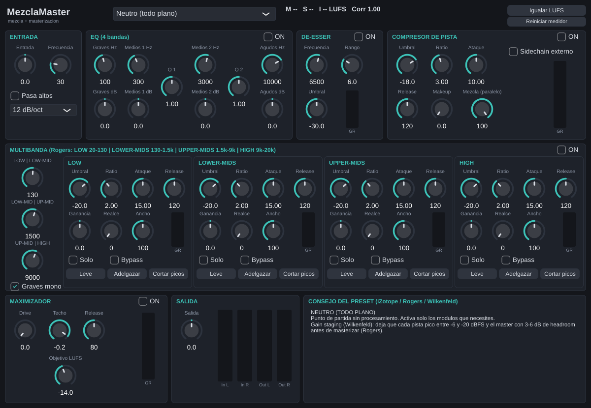

# MezclaMaster: plugin de mezcla y masterización para FL Studio



Plugin VST3 (Windows y macOS) para **FL Studio 12 o superior** y cualquier DAW
compatible con VST3. Reúne en un solo efecto las técnicas de tres libros:

| Libro | Lo que aporta al plugin |
|---|---|
| **John Rogers, *Audio Mastering Secrets*** | Multibanda de 4 bandas (LOW 20-130 Hz, LOWER-MIDS 130 Hz-1.5 kHz, UPPER-MIDS 1.5-9 kHz, HIGH 9-20 kHz). Botones **Leve** (4:1), **Adelgazar** (8:1) y **Cortar picos** (30:1). Realce espectral por banda, ancho estéreo en HIGH, techo del maximizador a -0.2 dB y presets por género a partir de sus calificaciones 1-10 de claridad, brillo, graves, compresión, ancho y volumen. |
| **iZotope, *Mixing Guide*** | Rangos de EQ por instrumento (bombo 200-500 "tubby", 2-4 kHz click; voz 400-800 "micro barato", 2-4 kHz nasal; acústica 4-6 kHz…), ratios por fuente, limitador en el bajo. |
| **Roy Wilkenfeld, *25 Mixing Tips*** | Gain staging (-6 a -20 dBFS), pasa altos en todo lo que no es bajo, recortes de 1-3 dB, compresión paralela, sidechain/ducking y "pegamento" en el bus (30/60 ms, 1-3 dB). |

## Cadena de procesamiento

```
Entrada → Pasa altos (12/24 dB) → EQ 4 bandas → De-esser → Compresor de pista
        → Multibanda 4 bandas (compresión + realce + ancho M/S + graves mono)
        → Maximizador (lookahead, techo garantizado) → Salida
```

Cada módulo tiene su botón **ON**. Con todo apagado (preset *Neutro*) el
plugin es transparente: la salida es idéntica a la entrada, solo retrasada
1.5 ms, y FL Studio compensa esa latencia por su cuenta.

Medidores: picos de entrada y salida, reducción de ganancia de cada módulo,
correlación estéreo y **LUFS** momentáneo, de corto plazo e integrado
(ITU-R BS.1770 / EBU R128).

## Presets

**Masterización** (en el canal Master, al final de la cadena):
Metal/Hard Rock (-8 LUFS), Rock clásico (-10), Pop-Rock/Punk/Country (-9),
Hip-Hop/Rap/Trap (-8), R&B (-9), Pop/Dance/EDM (-9), Cine/Clásica/Jazz (-10)
y Streaming (-14 LUFS, techo -1 dB).

> Rogers da sus volúmenes en números de ReplayGain. Para pasarlos a LUFS usé
> la equivalencia LUFS ≈ ReplayGain − 107 (referencia de 89 dB = -18 LUFS),
> así que tómalos como una aproximación.

**Mezcla** (en cada pista o bus del mixer): Voz principal, Coros, Bombo,
Caja, Bajo/808, Bus de batería (paralelo), Guitarra eléctrica, Guitarra
acústica, Piano/teclados, Sinte/pad, Ducking con sidechain y Bus maestro
(pegamento).

Cada preset muestra un **consejo** con la explicación tomada de los libros.

## Cómo masterizar con MezclaMaster (método de Rogers)

1. Exporta o deja la mezcla con **3-6 dB de headroom**, sin limitador en el Master.
2. Carga MezclaMaster en el slot **Master** y elige el preset del género.
3. Reproduce el coro (la parte más fuerte) y en cada banda pulsa **Leve**.
   Si un género fuerte se "rompe" a volumen alto, usa **Cortar picos** en UPPER-MIDS.
   Si una banda está enlodada o áspera, usa **Adelgazar**.
4. Usa **Solo** en cada banda y compárala con una canción de referencia,
   empezando por UPPER-MIDS, luego LOW, LOWER-MIDS y HIGH.
5. Pulsa **Igualar LUFS** 2-3 veces, dejando sonar unos 10 s entre cada vez,
   hasta que el LUFS integrado quede cerca del objetivo.
6. Descansa y vuelve con oídos frescos antes de exportar.

## Instalación en FL Studio

1. Descarga `MezclaMaster.vst3` (ver *Compilar* más abajo).
2. Cópialo a la carpeta de VST3:
   - Windows: `C:\Program Files\Common Files\VST3\`
   - macOS: `/Library/Audio/Plug-Ins/VST3/`
3. En FL Studio: **Options → Manage plugins → Find plugins**.
4. Agrégalo en un slot del mixer (Master para masterizar, cualquier pista para mezclar).

**Sidechain en FL Studio** (preset *Ducking con sidechain*): selecciona el
canal del bombo en el mixer, haz clic derecho en la flecha del canal destino
→ *Sidechain to this track*. En el plugin, en el menú de engrane →
*Processing*, asigna esa entrada al puerto lateral y activa **Sidechain externo**.

## Compilar

### Automático (GitHub Actions)
Cada push que cambie `MezclaMaster/` corre la prueba del DSP y compila:
- `MezclaMaster-Windows-x64` (FL Studio 64 bits)
- `MezclaMaster-Windows-Win32` (FL Studio 32 bits)
- `MezclaMaster-macOS` (VST3 + AU, universal)

Descárgalos desde la pestaña **Actions** del repositorio, en la sección *Artifacts* de la ejecución.

### Manual
Requiere CMake 3.22 o superior y Visual Studio 2022 (Windows), Xcode (Mac) o GCC/Clang (Linux).

```bash
cmake -S MezclaMaster -B build -DCMAKE_BUILD_TYPE=Release
```

```bash
cmake --build build --config Release --target MezclaMaster_VST3
```

JUCE 8.0.4 se descarga solo. Para formato VST2 (útil en versiones muy
viejas de FL), agrega `-DVST2_SDK_DIR=/ruta/al/vst2sdk` si tienes ese SDK de Steinberg.

### Prueba offline
```bash
cmake --build build --target MezclaMasterTest && ./build/MezclaMasterTest_artefacts/Release/MezclaMasterTest
```
Verifica la calibración LUFS, que el modo neutro sea transparente, que el
divisor de 4 bandas sume plano, que ningún preset pase el techo y que
*Igualar LUFS* llegue al objetivo.

## Estructura

```
MezclaMaster/
├── CMakeLists.txt
├── Source/
│   ├── DSP.h              compresor, realce, limitador lookahead, medidor LUFS
│   ├── PluginProcessor.*  parámetros y cadena de audio
│   ├── PluginEditor.*     interfaz
│   └── Presets.cpp        presets basados en los libros
└── tests/OfflineTest.cpp
```
